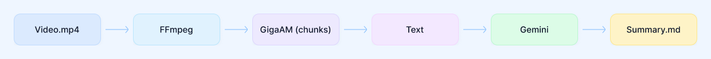

# Lecture to Notes

[](https://github.com/KarinaKarina6/lecture-to-notes/actions/workflows/ci.yml)

-lightgrey)


Транскрибация длинных видеолекций в текст с таймкодами и автоматический конспект. Оптимизировано под ноутбук с 4 ГБ VRAM (NVIDIA RTX 3050 Ti и аналогичные).

## Архитектура


## Пайплайн

1. FFmpeg → моно WAV 16 кГц
2. Нарезка на 20-секундные чанки (обход ограничений GigaAM на длинных файлах с очисткой CUDA VRAM после каждого чанка)
3. Инференс GigaAM-v3 (e2e_rnnt) с восстановлением таймкодов
4. (опционально) Конспект через LLM API (Gemini — в частности, `gemini-3.5-flash-lite`)

## Результат

- `output/<name>_transcript.txt` — транскрипт с таймкодами
- `output/<name>_notes.md` — конспект

## Установка

```bash
git clone <repo>
cd lecture-to-notes
python -m venv .venv
# Активация окружения:
# Linux / macOS:
source .venv/bin/activate
# Windows:
.venv\Scripts\activate
```

Затем установите зависимости в зависимости от того, используется ли у вас GPU (с поддержкой CUDA) или только CPU:

- **С использованием GPU (CUDA):**
  ```bash
  pip install -r requirements-cuda.txt 
  pip install -r requirements.txt
  ```


- **Только для CPU:**
  ```bash
  pip install -r requirements.txt
  ```
*(при необходимости разработки и тестирования установите также `pip install -r requirements-dev.txt`)*

## Запуск

```bash
python -m scripts.run_pipeline --input test.mp4
```

## Пример вывода

Фрагменты реального прогона (обезличены) — в папке [`examples/`](/example/):

- [`sample_transcript.txt`](/example/sample_transcript.txt) — транскрипт с таймкодами
- [`sample_notes.md`](/example/sample_notes.md) — автоматический конспект

## Тестирование

Для запуска модульных тестов используйте pytest:

```bash
python -m pytest
```

> **Совет:** Вы можете полностью отключить генерацию конспекта (оставив только сырой транскрипт), установив `enabled: false` для блока `summarize` в файле `config.yaml`. В этом случае наличие `GEMINI_API_KEY` в окружении не потребуется.
